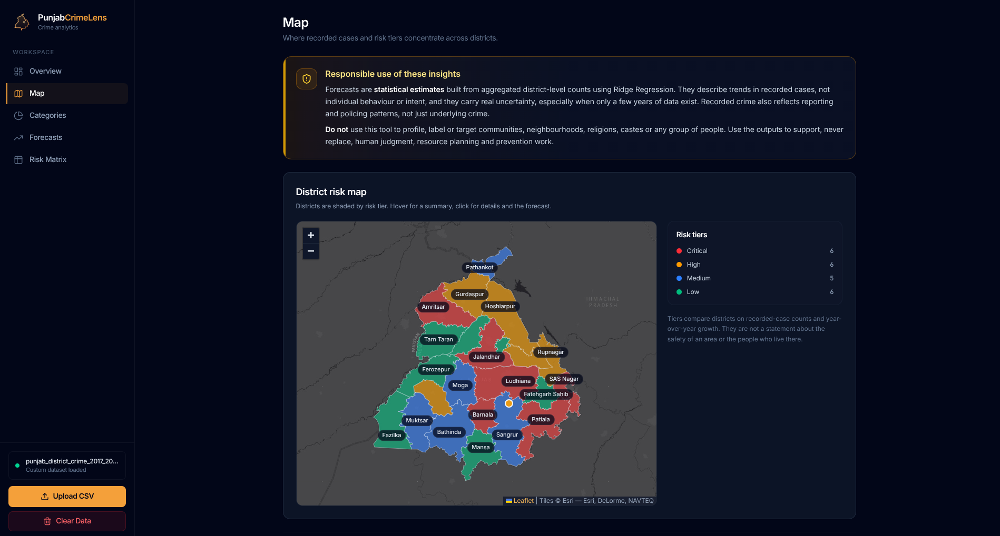
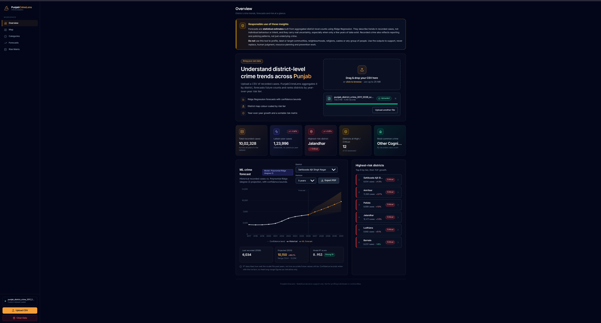
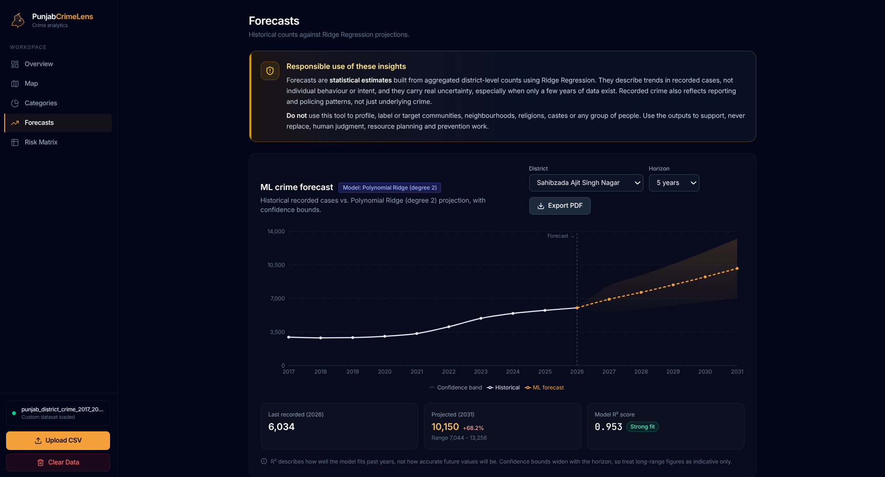
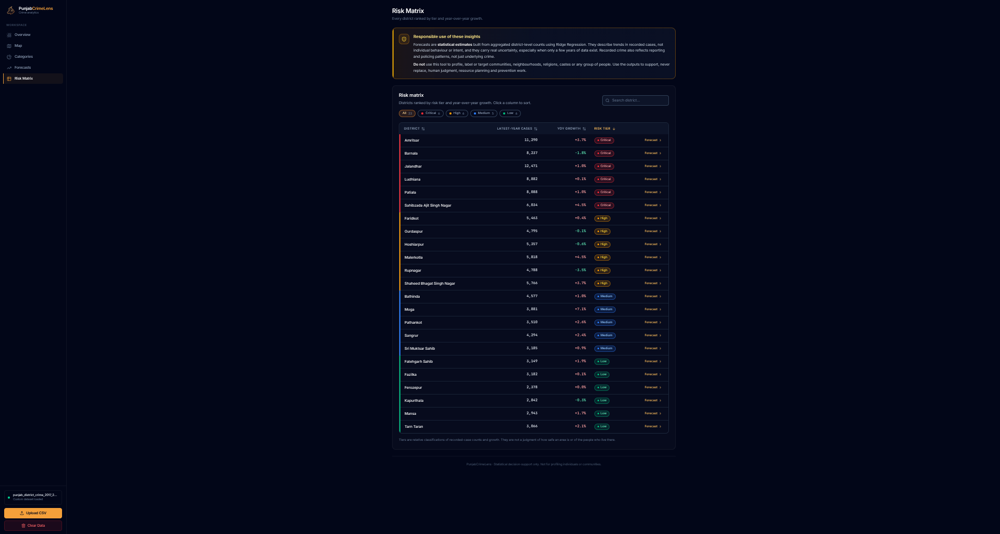
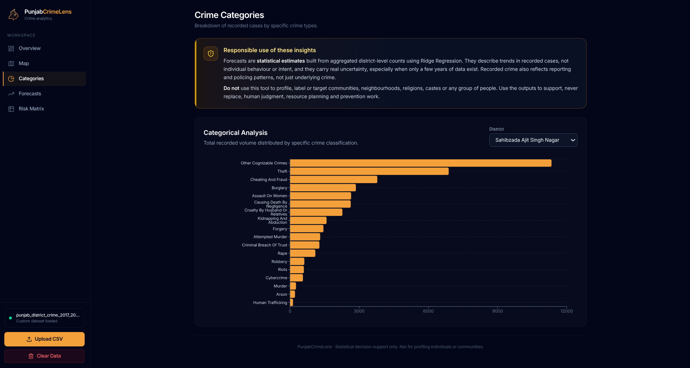
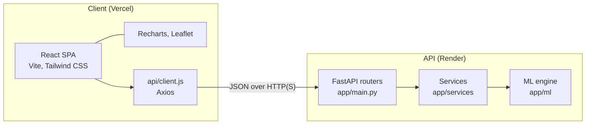

# PunjabCrimeLens


District-level crime analytics and statistical forecasting for the state of Punjab, India.

**Live demo:** [punjab-crime-lens.vercel.app](https://punjab-crime-lens.vercel.app) (hosted on free tiers; the backend may take a moment to wake after inactivity)



## Table of Contents

1. [Overview](#overview)
2. [Screenshots](#screenshots)
3. [Features](#features)
4. [System Architecture](#system-architecture)
5. [Machine Learning Methodology](#machine-learning-methodology)
6. [CSV Schema Requirements](#csv-schema-requirements)
7. [Local Installation](#local-installation)
8. [Deployment](#deployment)
9. [Limitations and Responsible Use](#limitations-and-responsible-use)

---

## Overview

PunjabCrimeLens is a decoupled, full-stack machine learning dashboard designed for state administrators. It converts raw tabular crime statistics into interactive geospatial risk maps, categorical breakdowns, and trend-aware forecasts.

The system is split into two independently deployable services:

- A **FastAPI** backend that ingests CSV data, aggregates it with Pandas, and runs an in-memory scikit-learn model-selection pipeline per request.
- A **React (Vite)** single-page application that renders the results as KPI cards, a district choropleth, forecast charts with confidence bands, and a sortable risk matrix.

**Intended use:** aggregate, district-level decision support (trend monitoring, resource planning, prevention programming). The system does not model individuals, neighbourhoods, or demographic groups. See [Limitations and Responsible Use](#limitations-and-responsible-use).

---

## Screenshots

<table>
  <tr>
    <td></td>
    <td></td>
  </tr>
  <tr>
    <td align="center"><sub><b>Overview</b>: KPIs, forecast and highest-risk districts</sub></td>
    <td align="center"><sub><b>Forecasts</b>: trend projection with widening confidence band</sub></td>
  </tr>
  <tr>
    <td></td>
    <td></td>
  </tr>
  <tr>
    <td align="center"><sub><b>Risk Matrix</b>: sortable, filterable district ranking</sub></td>
    <td align="center"><sub><b>Categories</b>: crime category breakdown</sub></td>
  </tr>
</table>

---

## Features

| Area | Capability |
|---|---|
| **Data ingestion** | Drag-and-drop CSV upload with client-side validation (extension, non-empty, 25 MB limit), upload progress, and toast feedback. Server-side schema enforcement (see [CSV Schema Requirements](#csv-schema-requirements)). |
| **KPI dashboard** | Total recorded cases, latest-year statewide cases with year-over-year (YoY) trend, highest-risk district, count of High/Critical districts, and most common crime category. |
| **Geospatial risk map** | Leaflet choropleth of district boundaries shaded by risk tier, collision-aware district labels, hover summaries, and detail popups that deep-link to the district forecast. Districts without a boundary polygon fall back to a point marker. |
| **Forecasting** | Per-district projections with a selectable horizon (1 to 10 years), a widening 95% confidence band, the selected model's name, and a goodness-of-fit (R²) indicator. |
| **Risk matrix** | Sortable, filterable, searchable table of all districts with latest-year cases, YoY growth, and risk tier. |
| **Anomaly detection** | Z-score flagging of statistically unusual annual totals, returned with each historical data point. |
| **Responsible-use controls** | Persistent in-app notice describing the statistical nature of the outputs and prohibiting community profiling. |
| **Interface** | Dark-mode sidebar layout, responsive drawer navigation on small screens, accessible controls (ARIA labels, keyboard-operable dropzone). |

---

## System Architecture

### Component overview



### Technology stack

| Layer | Technologies |
|---|---|
| Frontend | React 19, Vite 8, Tailwind CSS 4, Recharts 3, Leaflet 1.9 with react-leaflet 5, Axios, lucide-react |
| Backend | Python, FastAPI, Uvicorn, Pandas, NumPy |
| Machine learning | scikit-learn (no other modelling dependencies) |
| Hosting | Vercel (frontend), Render (backend), both on free tiers |

### Directory structure

```text
PunjabCrimeLens/
├── backend/
│   ├── requirements.txt
│   └── app/
│       ├── main.py                  # FastAPI application, routing, CORS
│       ├── ml/
│       │   ├── forecasting.py       # CrimeForecaster: model tournament, intervals, anomalies
│       │   └── risk_assessment.py   # District risk-tier classification
│       └── services/                # Business logic (data ingestion and aggregation)
└── frontend/
    ├── public/
    ├── index.html
    ├── package.json
    ├── vite.config.js
    └── src/
        ├── api/
        │   └── client.js            # Axios instance and typed endpoint wrappers
        ├── components/              # Sidebar, MetricsGrid, ForecastViewer, PunjabMap, RiskMatrix, ...
        ├── context/                 # Toast notification provider
        ├── data/
        │   └── punjab-districts.json  # District boundary GeoJSON
        ├── hooks/                   # Data-fetching hooks
        ├── utils/                   # District matching, geometry, risk styling, formatting
        ├── App.jsx
        ├── main.jsx
        └── index.css
```

### API reference

Interactive OpenAPI documentation is served by FastAPI at `http://localhost:8000/docs` when running locally.

| Method | Endpoint | Description |
|---|---|---|
| `POST` | `/api/upload` | Upload a CSV (`multipart/form-data`, field `file`). |
| `GET` | `/api/summary` | Dataset-level KPIs. |
| `GET` | `/api/risk-assessment` | Risk tier and YoY growth for every district. |
| `GET` | `/api/forecast?district={name}&years={n}` | Forecast for one district over `n` years. |

**`POST /api/upload`**

```json
{ "filename": "crime_2015_2024.csv", "total_records": 1840, "status": "success", "message": "..." }
```

**`GET /api/summary`**

```json
{ "total_cases": 128450, "highest_risk_district": "Ludhiana", "most_common_crime": "Theft" }
```

**`GET /api/risk-assessment`**

```json
[
  { "district": "Ludhiana", "latest_year_cases": 9120, "yoy_growth_percent": 4.35, "risk_tier": "Critical" }
]
```

`risk_tier` is one of `Low`, `Medium`, `High`, `Critical`.

**`GET /api/forecast`**

```json
{
  "district": "Ludhiana",
  "selected_model": "Ridge Regression",
  "historical": [
    { "year": 2023, "cases": 8740, "type": "historical", "z_score": 0.41, "is_anomaly": false }
  ],
  "forecast": [
    { "year": 2025, "cases": 9400, "ci_lower": 8650, "ci_upper": 10150, "type": "forecast" }
  ],
  "r2_score": 0.912
}
```

If a district has no data, or fewer than three annual observations, the forecaster returns an object of the form `{ "error": "<message>" }` instead.

### Statelessness

Models are fitted on demand for each forecast request and are not serialised or written to disk. Dataset state is held in server process memory; a free-tier cold start or restart resets it, so re-upload the dataset if results appear empty after a spin-down.

---

## Machine Learning Methodology

All modelling uses **scikit-learn, Pandas, and NumPy only**. No statistical-time-series packages (for example `statsmodels` or `prophet`) are required, which keeps the deployment footprint small and avoids native-compilation failures on constrained hosts.

### 1. Problem framing

Records are aggregated to annual case totals per district. The independent variable is the elapsed time index `t = year - first_year` (a centred, small-magnitude feature that keeps polynomial terms numerically stable), and the dependent variable is annual cases. Years are used as observed, so gaps in the series are respected rather than treated as consecutive.

### 2. Candidate models (AutoML tournament)

| Model | Pipeline | Regularisation | Eligibility |
|---|---|---|---|
| Ridge Regression | `StandardScaler` → `Ridge` | L2, alpha 0.3 | Always |
| Linear Regression | `LinearRegression` | None | Always |
| Polynomial Ridge (degree 2) | `PolynomialFeatures(2)` → `StandardScaler` → `Ridge` | L2, alpha 0.5 | 5 or more annual observations |
| Polynomial Ridge (degree 3) | `PolynomialFeatures(3)` → `StandardScaler` → `Ridge` | L2, alpha 1.0 | 8 or more annual observations |

Tree-based models are excluded: they cannot extrapolate beyond the range of the training data and produce flat projections.

### 3. Model selection: rolling-origin cross-validation

Candidates are compared on **out-of-sample** error, not training fit. For a series of `n` annual observations, each candidate is repeatedly trained on the first `k` years and evaluated on year `k + 1`, for `k` from `max(3, floor(n / 2))` to `n - 1`. Because the training window only ever contains past observations, the procedure avoids lookahead bias. The score is the root-mean-square error (RMSE) of these one-step-ahead forecasts.

Selection rules:

- Candidates are evaluated from simplest to most complex.
- A more complex model replaces the incumbent only if its RMSE is at least **5% lower**. This parsimony threshold prevents flexible models from winning on noise.
- With fewer than **5** annual observations, no tournament is run and Linear Regression is used.
- If every candidate fails to produce a finite score, the system falls back to Linear Regression.

### 4. Regularisation

With only 5 to 10 annual observations per district, unregularised high-degree polynomials interpolate noise. Polynomial pipelines therefore apply **L2 (Ridge) regularisation** to standardised features, with the penalty strength increasing with polynomial degree.

### 5. Plausibility guardrail

If a polynomial model is selected but its projection is implausible (any negative value, or any value above 2.5 times the historical maximum), the forecast is recomputed with the best-scoring degree-1 model and the response's `selected_model` field is suffixed with `(fallback)`.

### 6. Interval forecasting (95% confidence bands)

Each forecast point is returned with `ci_lower` and `ci_upper`, not a bare point estimate. The half-width at horizon `h` is:

```text
half_width(h) = 1.96 · σ · sqrt(1 + 1/n + (t_h − t̄)² / S_tt) · c(h)
```

where:

- `σ = max(σ_in-sample, RMSE_CV, 0.02 · mean(cases), 1)`. `σ_in-sample` is the residual standard deviation with `n − (degree + 1)` degrees of freedom, and `RMSE_CV` is the rolling-origin error of the selected model.
- `t̄` and `S_tt` are the mean and sum of squared deviations of the training time index, so the band **widens as the forecast moves away from the observed data**.
- `c(h) = 1` for degree-1 models and `c(h) = 1 + 0.25 · (degree − 1) · h` for polynomial models, which widens curved extrapolations faster.

Lower bounds and point forecasts are clipped at zero. The bands are an approximation based on the linear-trend prediction-interval formula, not a guarantee of exact 95% coverage.

### 7. Anomaly detection

For each district, annual totals are converted to Z-scores using the sample standard deviation. Years with `|z| > 2.0` are flagged (`is_anomaly: true`) and returned with their `z_score`.

Note that for `n` observations the maximum attainable `|z|` is `(n − 1) / √n`. A series therefore needs at least **6** annual observations before any year can exceed the threshold, and in practice only large spikes are flagged in short series.

### 8. Risk-tier classification

Risk tiers are assigned from the distribution of **latest-year case counts** across districts:

| Tier | Rule |
|---|---|
| Critical | cases ≥ 75th percentile |
| High | 50th percentile ≤ cases < 75th percentile |
| Medium | 25th percentile ≤ cases < 50th percentile |
| Low | cases < 25th percentile |

YoY growth is computed and reported alongside each district but does not influence its tier. Because tiers are quantile-based and relative, each tier is populated by construction. A tier reflects relative case volume among Punjab districts and is not an absolute measure of safety.

### 9. Reported metric

`r2_score` is the **in-sample** R² of the selected model fitted to the full series. It describes goodness of fit to historical years and is not a measure of forecast accuracy. Forecast reliability is better reflected by the width of the confidence band, which is derived from out-of-sample error.

---

## CSV Schema Requirements

The upload endpoint enforces a strict contract: the file must contain **exactly four columns**, with **lower-case** headers, named as follows.

| Column | Type | Constraints | Example |
|---|---|---|---|
| `year` | integer | Four-digit calendar year | `2023` |
| `district` | string | Punjab district name (see below) | `Ludhiana` |
| `crime_category` | string | Non-empty category label | `Theft` |
| `cases` | integer | Non-negative count of recorded cases | `412` |

Example:

```csv
year,district,crime_category,cases
2022,Ludhiana,Theft,398
2022,Ludhiana,Assault,121
2023,Ludhiana,Theft,412
2023,Amritsar,Theft,287
```

Data requirements:

- **Encoding and size:** UTF-8, up to 25 MB (enforced client-side).
- **Granularity:** one row per district, year, and crime category. Multiple rows for the same district and year are summed.
- **History length:** forecasting requires at least **3** annual observations per district. Model selection is active from **5**, polynomial candidates from **5** (degree 2) and **8** (degree 3), and anomaly flagging is effective from **6**.
- **District names:** matching is case-insensitive and ignores punctuation and the words "district" and "city". Common alternative spellings and renamings are recognised (for example Mohali, SAS Nagar and Sahibzada Ajit Singh Nagar; Nawanshahr and Shaheed/Shahid Bhagat Singh Nagar; Ropar and Rupnagar; Firozpur and Ferozepur; Muktsar and Sri Muktsar Sahib). Names not in the alias table still appear in tables and forecasts but cannot be placed on the map. Add them in `frontend/src/utils/districts.js`.

---

## Local Installation

The hosted deployments run on free tiers and may be spun down when idle, so the first request after a period of inactivity can be slow or fail. Running both services locally is the reliable way to use or demonstrate the application.

### Prerequisites

- Git
- Python 3.10 or newer
- Node.js 20.19 or newer (or 22.12+) and npm

### 1. Clone the repository

```bash
git clone https://github.com/ShashankJindaldev/PunjabCrimeLens.git
cd PunjabCrimeLens
```

### 2. Backend setup

```bash
cd backend
python -m venv .venv
```

Activate the virtual environment:

```bash
# Linux / macOS
source .venv/bin/activate

# Windows (PowerShell)
.venv\Scripts\Activate.ps1
```

Install dependencies and start the server:

```bash
pip install -r requirements.txt
uvicorn app.main:app --reload
```

The API is now available at `http://localhost:8000`, with interactive documentation at `http://localhost:8000/docs`.

### 3. Frontend setup

In a second terminal:

```bash
cd frontend
npm install
npm run dev
```

The application is now available at `http://localhost:5173`.

> **Important:** the frontend expects the FastAPI backend to be running on **port 8000** for `src/api/client.js` to function. The default base URL is `http://127.0.0.1:8000`. To target a different host or port, create `frontend/.env` containing `VITE_API_URL=http://<host>:<port>` and restart the dev server.

### Troubleshooting

| Symptom | Likely cause and resolution |
|---|---|
| "Cannot reach the API" banner | The backend is not running, or is on a port other than 8000. Start it with `uvicorn app.main:app --reload`, or set `VITE_API_URL`. |
| Requests blocked by CORS | The backend's allowed origins must include `http://localhost:5173` and `http://127.0.0.1:5173`. |
| Map shows no districts | Confirm `frontend/src/data/punjab-districts.json` exists with that exact lower-case file name. |
| Import errors on Linux | File names are case-sensitive; check the casing of imported paths. |
| Port already in use | Stop the other process, or run `uvicorn app.main:app --reload --port <port>` and set `VITE_API_URL` to match. |

---

## Deployment

Reference configuration for the hosted environments:

| | Frontend (Vercel) | Backend (Render) |
|---|---|---|
| Root directory | `frontend` | `backend` |
| Build command | `npm run build` | `pip install -r requirements.txt` |
| Output / start | Output directory `dist` | `uvicorn app.main:app --host 0.0.0.0 --port $PORT` |
| Environment | `VITE_API_URL` set to the Render service URL | CORS allowed origins set to the Vercel domain |

Free-tier instances may be suspended after a period of inactivity, which adds cold-start latency to the first request.

---

## Limitations and Responsible Use

- **Statistical estimates, not predictions of events.** Forecasts extrapolate aggregate trends from a small number of annual observations. Projections beyond two to three years are indicative only; the confidence band widens with the horizon to reflect this.
- **Recorded crime is not total crime.** Counts depend on reporting behaviour and policing practice as well as underlying incidence.
- **Aggregate analysis only.** The system must not be used to profile, label, or target communities, neighbourhoods, religions, castes, or any group of people. Outputs are intended to support, not replace, human judgment.
- **Relative risk tiers.** Tiers are quartiles of latest-year case counts. They rank districts against each other and do not indicate absolute danger or safety.
- **Boundary data vintage.** The district boundary file reflects earlier administrative boundaries and contains 22 polygons. Malerkotla, created in 2021, is rendered as a point marker and its area is still contained within the Sangrur polygon.
- **Small samples.** With 5 to 10 observations per district, goodness-of-fit metrics and anomaly flags have limited statistical power.
